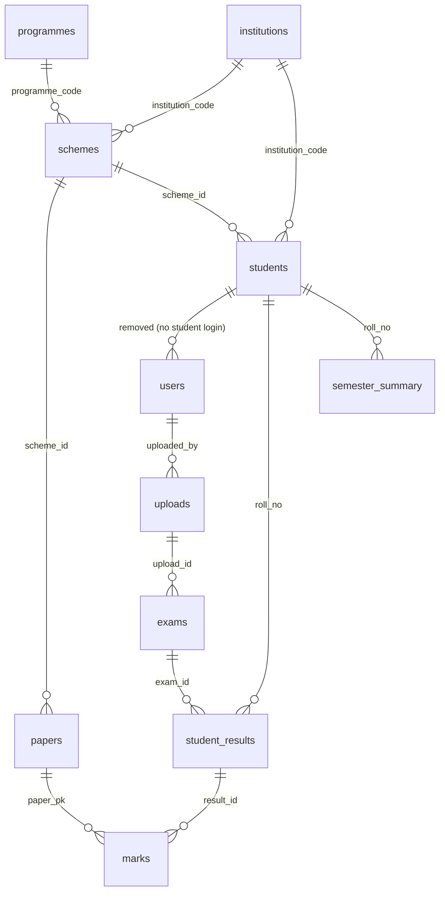

# ResultLens – Project Overview

> GGSIPU result PDF → extracted marks → SGPA/CGPA → public result lookup, toppers, analytics.
> Faculty uploads; students look up by enrollment number + semester (no student login).

## 1. Architecture

Monorepo, three layers. All traffic goes through a versioned REST API; the client never touches the DB.

```
client/ (Vite React) ──Axios + httpOnly cookie──▶ server/ (Express, /api/v1) ──pg Pool──▶ PostgreSQL
                                                        │
                                              pdfjs-dist │ transactional ingest
                                                        ▼
                                              parsers → services → repositories → tables
```

**Backend layering (strict):**

| Layer | Folder | Rule |
|---|---|---|
| Routes | `src/routes/` | URL + middleware chain (`auth`, `requireRole`, `validate`, `upload`) only |
| Controllers | `src/controllers/` | Thin: parse request → call service → `apiResponse`. No SQL, no business rules |
| Services | `src/services/` | Business logic + transactions (`auth`, `ingestion`, `results`, `toppers`, `analytics`) |
| Repositories | `src/repositories/` | ALL SQL lives here, parameterized only, one file per domain |
| Parsers | `src/parsers/` | Pure text → structured data. No I/O |
| Utils | `src/utils/` | Anything used twice (`ApiError`, `apiResponse`, `calculations`, `rollNumber`, `hash`, `pagination`, `rankingSql`) |

Consistent response shape everywhere: `{ success, data, message }`. All errors thrown as `ApiError`, formatted by one central `errorHandler`.

**Frontend (feature-based):** `app/` (router, providers) → `pages/` → `features/{auth,upload,student,toppers,analytics}` (each with `api/`, `hooks/`, `components/`) → shared `components/ui/` primitives (one `Table` shared by marks + toppers). Data fetching only via TanStack Query inside feature hooks; no direct Axios in components.

## 2. Tech stack — what and why

| Choice | Why |
|---|---|
| React (Vite) + React Router | Component UI + client routing; Vite for fast dev/build |
| Axios + TanStack Query | Axios carries the session cookie (`withCredentials`); Query gives caching, loading/error states per feature hook |
| react-icons, Tailwind, Manrope | Single icon set; utility styling with brand tokens (indigo `#2b3a8c/#4b5fd6`, amber `#f5a524`); light/dark via CSS vars |
| react-hook-form + zod | Client validation mirroring backend schemas |
| Node.js + Express | Same language both ends; minimal, explicit middleware chain |
| PostgreSQL + `pg` Pool (thin layer, no ORM) | Relational result data (students↔papers↔marks) fits SQL; window functions (`RANK()`, `ROW_NUMBER()`) do rankings/latest-attempt logic in-DB; thin layer keeps SQL visible and reviewable |
| JWT in httpOnly cookie + bcrypt | XSS-safe session (JS can't read the token); hashed passwords; role in payload for `requireRole('faculty'|'admin')` gates |
| `pdfjs-dist` | Page-by-page text with x/y positions (needed to rebuild lines in reading order); lazy-imported so tests/cold starts never load it |
| Zod | Every body/query/params validated via `validate.js` middleware |
| multer (memory storage, PDF-only, 10 MB) | Single-file upload, no disk cleanup, rejects non-PDFs before parsing |
| Vitest | Fast unit tests for calculations, roll numbers, parser fixtures, services (fakes injected, no live DB needed) |
| Local PostgreSQL (no Docker) | Matches the machine setup; `migrate.js` + `seed.js` scripts |

## 3. PDF extraction approach

GGSIPU PDFs alternate **Scheme pages** (institution + paper table) and **Result pages** (exam header + student blocks). Pipeline:

```
PDF bytes → extractText (pdfjs, per-page lines) → parseResultText (state machine)
→ ingestPdf (SHA-256 dedupe → single transaction of batched upserts → recompute summaries)
```

1. **Line reconstruction** (`pdfTextExtractor.js`): pdfjs returns positioned fragments; `groupItemsIntoLines` clusters by y (±2 units), sorts top-down / left-to-right. Pure and unit-tested.
2. **Line matchers** (`lineMatchers.js`): one small regex function per line type — institution header, `SchemeID`, `Sem./Year`, exam header (`Batch/REGULAR|REAPPEAR`), student header (first 11 digits = roll, name until `SID:`), paper entry `020301(4)`, score line (internal `-` allowed, external `A` = absent), total line (`84(A+)`, grace `40(P)*`, odd `A(F)`, lone `A`), scheme paper rows (anchored from both ends: S.No/PaperID/Code + `THEORY|PRACTICAL` marker + minor/major/max/pass tail; minor `--` → null).
3. **State machine** (`resultParser.js`): walks lines carrying `{ institution, scheme, semester, exam }` context; builds institutions/schemes/papers/exams/students/results. Never throws on bad lines (warns, max 50, returned with the upload). Credits-secured (trailing lone number, incl. `0`) is distinguished from page footers by forward-scan: next mark-line = footer, next header/EOF = block end, plus credit-sum range check, first-wins.
4. **Ingestion** (`ingestion.service.js`): SHA-256 hash → 409 if already uploaded; parse → one Postgres transaction with batched `INSERT … ON CONFLICT DO UPDATE` upserts (institutions, programmes, schemes, papers incl. `UNLISTED` stubs for result-only paper IDs, students, exams with semester resolution, results, marks) → recompute SGPA/CGPA/ranks pre-COMMIT → `{ upload, stats, warnings }`.

## 4. Database tables (PostgreSQL, 12 tables)

- `programmes` – `code` PK, name (names unknown from PDF; code doubles as name)
- `institutions` – `code` PK, name (**keyed by code**: same code renamed over time updates the row)
- `schemes` – `scheme_id` PK, institution/programme FKs, `semester`
- `papers` – serial PK, `UNIQUE(scheme_id, paper_id)` (**names/credits differ per scheme**), code, name, credits, type/mode/kind, minor/major/max/pass marks
- `grade_scale` – grade PK, min/max marks, grade point (seeded O…F bands; logic reads this table, never hard-codes)
- `students` – `roll_no` (11-digit) PK, name, SID, institution/programme/batch/scheme
- `uploads` – serial PK, `file_hash` UNIQUE (SHA-256 dedupe), filename, uploader, timestamp
- `exams` – serial PK, `UNIQUE(batch, session, exam_type, semester)`, upload FK
- `student_results` – serial PK, `UNIQUE(exam_id, roll_no)`, exam_type, `credits_secured`
- `marks` – serial PK, `UNIQUE(result_id, paper_pk)`, internal/external (nullable) / total / grade, `is_absent`, `is_grace`
- `semester_summary` – `PK(roll_no, semester)`, sgpa, cgpa, total_credits, has_backlog, college_rank, university_rank
- `users` – serial PK, role `faculty|admin` only, username UNIQUE, password_hash (+name/email)

Indexes: `marks(paper_pk, total DESC)`, `students(institution_code)`, `student_results(exam_id)`.

### ER diagram



## 5. Important modules (what each does)

| Module | Location | Responsibility |
|---|---|---|
| Result parser | `server/src/parsers/` | `pdfTextExtractor` (pdfjs → page lines) + `lineMatchers` (regex per line type) + `resultParser` (state machine → structured object). Pure, fixture-tested |
| Ingestion | `server/src/services/ingestion.service.js` + `repositories/{catalog,records,uploads}.repo.js` | Hash dedupe → transactional batched upserts → summary recompute. Upload history |
| Auth | `services/auth.service.js`, `routes/auth.routes.js`, `routes/admin.routes.js` | Faculty/admin login (JWT cookie), me/logout, admin-creates-professor. No student auth |
| Results & summaries | `services/results.service.js` + `repositories/summary.repo.js` + `utils/calculations.js` | Latest-attempt marks → pure SGPA/CGPA/backlog math → `semester_summary` + global `RANK()` refresh |
| Toppers | `repositories/toppers.repo.js` (+ `services/toppers.service.js`, Phase 6) | Overall (max CGPA), semester (SGPA), college (CGPA in institution), subject (top total + all ties) |
| Upload UI | `client/src/features/upload/` + `pages/UploadPage.jsx` | `PdfDropzone` (drag-drop, PDF/size guards) + `UploadProgress` + history table; `/upload` behind `ProtectedRoute(faculty, admin)` |
| Result lookup UI | `client/src/features/student/` + `pages/StudentResultPage.jsx` (Phase 5) | Public enrollment-no + semester form → marks table (shared `Table`), SGPA/CGPA + rank cards |

Calculation rules (single source: `utils/calculations.js`): SGPA = Σ(credits×gp)/Σ(credits), fails/absent = 0, 2-decimal rounding; reappear = latest attempt per paper; CGPA = Σ(SGPA×credits)/Σ(credits); backlog = any F/absent in latest attempts.

## 6. Homepage layout

Public landing: hero + result lookup front and center (no login for students); faculty sees Upload entry after sign-in.

```
┌──────────────────────────────────────────────────────────────┐
│ ResultLens        Toppers   Analytics   Upload*   [Sign in]   │  ← sticky header
├──────────────────────────────────────────────────────────────┤
│  HERO                                                        │
│  GGSIPU Result Analyzer & CGPA Calculator                    │
│  Upload once. Look up any enrollment number.                 │
│                                                              │
│  ┌─────────────────────┐  ┌───────────────────────┐         │
│  │ Enrollment number   │  │ Semester  [3 ▾]  [Go]  │         │  ← public lookup
│  └─────────────────────┘  └───────────────────────┘         │
├──────────────────────────────────────────────────────────────┤
│  How it works:  1 Upload PDF → 2 Extract marks →             │
│                 3 Calculate SGPA & CGPA → 4 View rankings    │  ← 4-step strip
├──────────────────────────────────────────────────────────────┤
│  [Stat] Students  [Stat] Colleges  [Stat] Avg CGPA           │
│  [Stat] Pass rate                        (stat cards)        │
├──────────────────────────────────────────────────────────────┤
│  Faculty? Sign in to upload the result PDF. (dropzone lives  │
│  on /upload – visitors only see this prompt)                 │
└──────────────────────────────────────────────────────────────┘
* Upload nav item + dropzone render only for faculty/admin sessions.
```

Result page (after lookup): summary card (SGPA per semester + CGPA + college/university rank) over a subject-wise marks table (Int. | Ext. | Total | Grade pill). Toppers page: tabs Overall / Semester / College / Subject → podium top-3 + full ranked table with filters. Analytics page: avg SGPA by college, pass % by subject, pass rate, avg/highest CGPA, backlog count.
